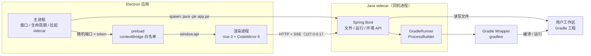
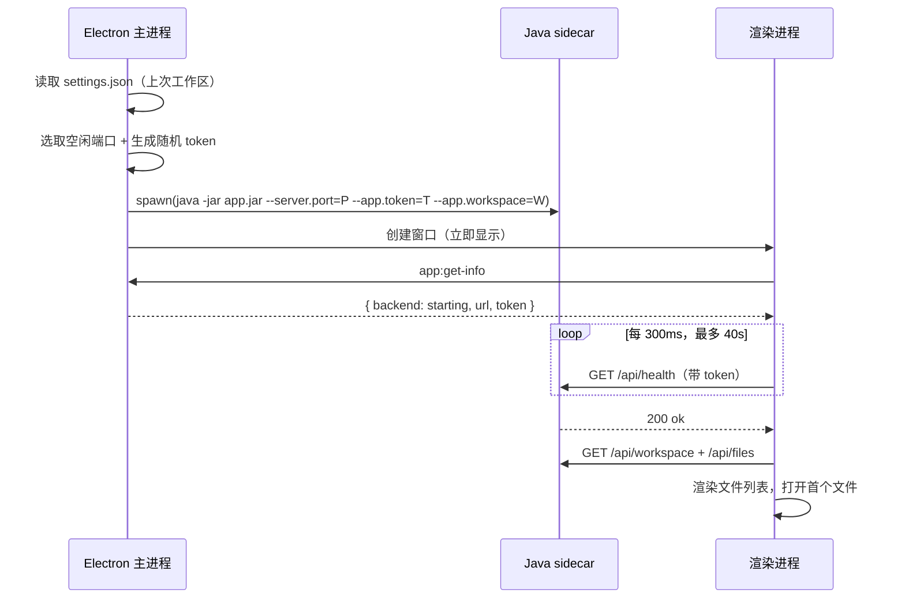
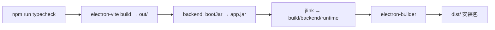

# GMCH IDE 技术方案

| 项 | 内容 |
| --- | --- |
| 文档编号 | TECH-001 |
| 版本 | v0.1 |
| 对应发布 | v0.1.0 |
| 日期 | 2026-11-12 |

## 1. 总体架构

采用 **Electron 壳 + Vue 3 渲染层 + Java sidecar（Spring Boot）+ Gradle 子进程** 的四层结构。



**为什么保留 Java 后端**：构建、诊断、后续 LSP/索引都在 JVM 生态内；Electron 主进程只负责窗口与进程治理，不承载业务，避免把 IDE 能力绑死在 Node 侧。

## 2. 进程模型与启动时序

### 2.1 三类进程

| 进程 | 数量 | 职责 | 生命周期 |
| --- | --- | --- | --- |
| Electron 主进程 | 1 | 窗口、菜单、单实例、sidecar 管理、设置持久化 | 应用生命周期 |
| 渲染进程 | 1 | UI、编辑器、HTTP/SSE 客户端 | 跟随窗口 |
| Java sidecar | 1 | 文件 API、Gradle 执行、环境探测 | 由主进程拉起与回收 |
| Gradle 子进程 | 0–1 | 实际编译/运行 | 单次任务，可终止 |

### 2.2 启动握手



关键点：

1. **端口由主进程分配**（`net.createServer().listen(0)`），而不是解析 Spring 日志，避免解析失败；
2. **token 由主进程生成**，通过命令行参数传给 sidecar，渲染进程经 IPC 获取；后端所有 `/api/**` 校验 token（`/api/health` 除外）；
3. **窗口先显示**，后端就绪是异步状态，避免被 JVM 启动拖慢首屏；
4. **后端缺失时降级**：开发环境未执行 `npm run backend:build` 时，界面给出明确提示而不是白屏。

### 2.3 退出时序

1. 用户关闭窗口 → 主进程 `close` 事件 `preventDefault()`，向渲染进程发 `app:close-request`；
2. 渲染进程检查未保存内容 → 保存/放弃/取消；
3. 确认后调用 `app:close` → 主进程置 `allowClose`，真正关闭；
4. `before-quit` → `stopBackend()`：`SIGTERM`，3s 未退出则强杀；
5. sidecar 的 JVM shutdown hook 终止 Gradle 子进程树，保证无残留。

## 3. 目录结构

```
gmch_ide/
├─ docs/                     需求、技术方案、规范、发布验证、路线图
├─ src/
│  ├─ main/                  Electron 主进程
│  │  ├─ index.ts            窗口、菜单、IPC、单实例、关闭守卫
│  │  └─ backend.ts          sidecar 启动/健康检查/停止/切换工作区
│  ├─ preload/               能力白名单（window.api）
│  ├─ shared/                跨进程纯类型
│  └─ renderer/              Vue 3 渲染进程
│     ├─ index.html
│     └─ src/
│        ├─ App.vue
│        ├─ api/client.ts    HTTP + SSE 封装
│        ├─ stores/ide.ts    Pinia：工作区/文件/运行状态
│        ├─ components/      FileList / CodeEditor / OutputPanel / StatusBar
│        └─ styles/
├─ backend/                  Spring Boot sidecar（Gradle 工程）
│  ├─ build.gradle
│  └─ src/main/java/com/gmch/ide/
│     ├─ Application.java
│     ├─ config/             Workspace / TokenFilter / WebConfig
│     ├─ api/                Health / Workspace / File / Run / Env
│     └─ service/            GradleRunner
├─ scripts/                  构建与环境脚本
│  ├─ doctor.mjs             环境自检
│  ├─ build-backend.mjs      bootJar + jlink 运行时
│  └─ verify-release.mjs     产物校验
├─ build/                    electron-builder 资源 + 后端构建输出（gitignore）
├─ resources/                运行时资源
└─ .github/workflows/        三平台构建与发版
```

## 4. 技术选型

| 层 | 选型 | 版本 | 理由 |
| --- | --- | --- | --- |
| 桌面壳 | Electron | ^39.2.6 | Chromium 一致、自动更新/签名生态成熟 |
| 构建 | electron-vite | ^5.0.0（Vite 7） | 主/预加载/渲染三段构建，开发热更新 |
| UI | Vue 3 + Pinia | ^3.5.25 / ^3.0.4 | 团队技术栈一致 |
| 编辑器 | CodeMirror 6（`basicSetup` + `@codemirror/lang-java`） | ^6.x | 体积小、无 worker 配置、输入延迟低 |
| 高亮 | Lezer 增量解析 | 随 CM6 | 打字零网络请求 |
| 后端 | Spring Boot | 3.5.x | 团队熟悉，生态完整 |
| 构建执行 | Gradle Wrapper + `ProcessBuilder` | 工作区自带 | 不绑定 Gradle 版本，复用 daemon |
| 通信 | HTTP + SSE | — | 构建输出单向流，SSE 比 WebSocket 少一半代码 |
| 打包 | electron-builder | ^26 | NSIS / DMG / AppImage / deb 全覆盖 |
| 运行时 | jlink 裁剪 JRE | JDK 21 | 约 50MB，避免整包 JRE |

## 5. 关键决策（ADR 简版）

### ADR-01 编辑器选 CodeMirror 6，不选 Monaco

- **背景**：v0.1 只需要「编辑 + 高亮 + 搜索」，不需要补全、跳转、diff、minimap。
- **决策**：CM6 + `basicSetup` + Java 语言包。
- **代价**：后续要补 LSP 时需要额外桥接（`@codemirror/lsp-client` 或自研 provider）；届时评估是否切换 Monaco。
- **复核触发**：v0.3 引入 LSP 时。

### ADR-02 通信选 SSE，不选 WebSocket

- **背景**：v0.1 只有「构建输出」一条流，且是单向的。
- **决策**：`SseEmitter` + `EventSource`；token 通过查询参数传递（`EventSource` 不支持自定义头）。
- **代价**：未来双向能力（LSP）需要换成 WebSocket 或复用 POST + 流式响应。

### ADR-03 Java 后端持有工作区并执行 Gradle

- **背景**：编译/运行是 JVM 生态能力，后续诊断、索引也会在 JVM 侧。
- **决策**：Electron 主进程只管进程与窗口；文件 IO、Gradle 执行都在 sidecar。
- **代价**：多一个进程与一次 IPC 跳转；收益是渲染层无 Node 能力，安全边界清晰。

### ADR-04 打包 jlink 裁剪 JRE，不打包完整 JDK

- **背景**：安装包体积敏感；用户机器通常已有 JDK 用于编译。
- **决策**：sidecar 自带 jlink 运行时；`gradlew` 使用用户环境 JDK。
- **代价**：用户必须安装 JDK 17+；jlink 模块清单需要随 Spring 升级复核。

### ADR-05 使用系统原生窗口边框

- **背景**：自定义标题栏需要额外处理拖拽区、窗口按钮、全屏、macOS 交通灯。
- **决策**：v0.1 使用原生边框，把预算留给编辑与构建链路。
- **代价**：视觉上与「IDE 感」有差距，v0.2 再替换。

### ADR-06 渲染进程直连 127.0.0.1，不做主进程代理

- **背景**：主进程代理可以隐藏 token，但 SSE 需要额外转发层。
- **决策**：后端开启 CORS（任意来源），依靠「仅绑定 127.0.0.1 + 随机 token」防护；CSP 限制 `connect-src`。
- **代价**：token 存在于渲染进程内存；如后续加载远程内容，需改为主进程代理。

### ADR-07 文件对话框不传父窗口

- **背景**：Electron 在 Windows 上解析 `dialog.showOpenDialog(parentWindow, ...)` 的父 HWND 存在已知崩溃（`0xc000041d`，electron#45673，修复见 PR#53583）；「新建工程 → 浏览…」会触发。
- **决策**：主进程调用 `dialog.showOpenDialog(options)` 不传父窗口，并在打开/返回前后写 `startup.log`；等 Electron 版本包含修复后再评估是否恢复父窗口。
- **代价**：对话框不再是主窗口的模态子窗口，用户可以在对话框打开时切回主窗口；对当前功能可接受。

## 6. 安全基线
| 项 | 措施 |
| --- | --- |
| 进程隔离 | `contextIsolation: true`、`sandbox: true`、`nodeIntegration: false` |
| 能力白名单 | preload 只暴露 `window.api` 的对象方法，不暴露 `ipcRenderer` |
| 后端监听 | 仅 `127.0.0.1`，随机端口 |
| 鉴权 | 每次启动生成 UUID token，`X-GMCH-Token` 头或 `token` 查询参数 |
| 路径 | 所有文件路径 `normalize()` 后必须位于工作区内，否则 400 |
| 导航 | `will-navigate` / `setWindowOpenHandler` 拦截，外部链接交给系统浏览器 |
| CSP | `default-src 'self'`，`connect-src` 仅放行 `127.0.0.1` |
| 命令执行 | 仅执行工作区内 `gradlew`，任务名白名单（`run` / `compileJava` / `test` / `build`） |

## 7. 构建与打包流水线



- 产物目录：`out/`（应用代码）、`build/backend/`（jar + runtime）、`dist/`（安装包）。
- `extraResources` 把 `build/backend` 与 `resources` 复制进安装包。
- 三平台构建各自在原生 runner 上执行（见 `.github/workflows/release.yml`）。

## 8. 已知限制（v0.1.0）

1. 未签名、未公证：Windows SmartScreen 与 macOS Gatekeeper 会拦截，需手动放行。
2. 无自动更新：升级需重新下载安装包。
3. 单工作区、单文件、无标签页：切换文件会提示保存。
4. 无 LSP：没有补全、跳转、诊断；编译错误只能看输出。
5. 依赖用户 JDK：未内置 JDK，环境缺失时只能编辑不能构建。
6. 构建任务串行：同一时刻只允许一个 Gradle 任务。
7. 输出为纯文本：不做 ANSI 着色与错误行跳转（v0.2）。
